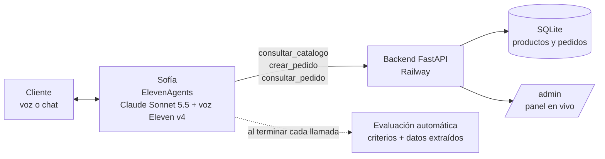

# Sofía · Avícola Las Tres Cruces

Agente de voz y chat en español colombiano que atiende a los clientes de una avícola de Bucaramanga: consulta el catálogo y el stock en tiempo real, toma pedidos completos (a domicilio o para recoger) y descuenta el inventario. Está construido en **ElevenAgents (ElevenLabs)** sobre un backend propio en **FastAPI + SQLite**.

Es un prototipo para el negocio real de un amigo. **Todos los datos son de prueba**: productos y precios aproximados de Bucaramanga, y dirección y horario provisionales hasta tener los reales.

- **Video demo (90 s):** <https://youtu.be/Dbhbu4CBeDc>
- **Probar el agente:** <https://elevenlabs.io/app/talk-to?agent_id=agent_7201m4h8sssbf2na0f8w29fbvwrb>
- **Ver el inventario y los pedidos en vivo:** <https://web-production-2c721.up.railway.app/admin>

Haz un pedido por voz con el panel abierto al lado y verás cómo baja el stock. Usa datos inventados: el panel es público.

## Cómo funciona



1. El cliente habla con Sofía por voz o chat.
2. Antes de dar cualquier precio, Sofía consulta el catálogo (`GET /api/productos`). Nunca dice precios de memoria.
3. Arma el pedido, ofrece un complemento una sola vez, pide los datos uno por uno, repite el resumen con el total y espera un sí explícito.
4. Solo entonces crea el pedido (`POST /api/pedidos`). El backend valida el stock y descuenta en una sola transacción. Si falta stock, responde `409` con qué producto y cuánto hay, y Sofía ofrece ajustar.
5. Al colgar, ElevenLabs evalúa la conversación y extrae el número de pedido, el total y la modalidad.

## La agente

- **Personalidad:** Sofía es paisa y vive hace años en Bucaramanga. La voz elegida tiene acento paisa, así que la personalidad se ajustó a la voz y no al revés: acento y vocabulario tienen que coincidir. Trata de usted, usa expresiones paisas con moderación y conoce lo santandereano (carne oreada, bocadillo veleño, hormigas culonas).
- **Prompt:** [`agent/system_prompt.md`](agent/system_prompt.md), con secciones de personalidad, entorno, tono, objetivo, negocio, herramientas y límites.
- **Configuración:** [`agent/agent.json`](agent/agent.json): LLM, voz, turnos, soft timeout, evaluación. Las tools están en [`agent/tools.json`](agent/tools.json).
- **Tests y evaluación:** [`agent/tests.md`](agent/tests.md). Son 4 tests adjuntos al agente (2 de tool call y 2 simulaciones) y pasan 4/4.

### Decisiones de diseño de voz

| Problema observado en llamadas reales | Cambio |
|---|---|
| Al preguntar "¿qué tienen?", leía los 16 productos (34 s). | Resume en una frase con 2 o 3 destacados y pregunta qué le interesa. |
| Interrumpía cuando el cliente dictaba el celular por partes. | Responde solo "ajá" hasta tener los 10 dígitos y lo repite una sola vez. |
| El número de pedido "te ce cero cero cero uno" no se entendía. | Dice "su pedido es el número uno". Internamente lo convierte a `TC-0001` para consultarlo. |
| La frase de relleno salía en casi todos los turnos. | Soft timeout de 1,5 a 2,5 s, con frases en orden aleatorio. |
| Decía "mi reina" antes de saber con quién hablaba. | Los apelativos con género se usan solo cuando ya conoce el nombre. |
| Una conversación quedó abierta 10 minutos en silencio. | Cuelga tras 30 s sin respuesta. |

En la última prueba de voz el tiempo de respuesta fue de alrededor de 1 segundo por turno, y cerca de 3 segundos al crear el pedido.

## Backend

Python 3.12, FastAPI, SQLite (`sqlite3`, sin ORM), Pydantic v2. Desplegado en Railway.

### Correr local

```bash
python3.12 -m venv .venv
source .venv/bin/activate
pip install -r requirements.txt
cp .env.example .env        # editar API_KEY
uvicorn app.main:app --reload   # http://localhost:8000/admin
pytest                          # 8 tests, DB temporal
```

| Variable  | Obligatoria | Default            | Descripción                                   |
|-----------|-------------|--------------------|-----------------------------------------------|
| `API_KEY` | sí          | —                  | Clave que exige el header `X-API-Key` en `/api/*`. Sin ella el servidor no arranca. |
| `DB_PATH` | no          | `./data/tienda.db` | Archivo SQLite; la carpeta se crea sola.       |
| `PORT`    | no          | `8000`             | Lo inyecta la plataforma de despliegue.        |

### Endpoints

Todos los `/api/*`, salvo `/api/health`, exigen `X-API-Key`. Las respuestas son JSON en español, pensadas para que la agente se las cuente al cliente.

| Método  | Ruta                        | Qué hace                                                        |
|---------|-----------------------------|-----------------------------------------------------------------|
| `GET`   | `/api/health`               | `{"ok": true}`. Sin API key.                                    |
| `GET`   | `/api/negocio`              | Horario, zonas y costo de domicilio.                            |
| `GET`   | `/api/productos`            | Catálogo. Filtros: `q` (sin tildes ni mayúsculas), `categoria`, `solo_disponibles`. |
| `GET`   | `/api/productos/{id}`       | Un producto. `404` si no existe.                                |
| `POST`  | `/api/pedidos`              | Crea el pedido y descuenta stock en una transacción. `201`.     |
| `GET`   | `/api/pedidos`              | Últimos pedidos. Filtros: `estado`, `limite`.                   |
| `GET`   | `/api/pedidos/{numero}`     | Un pedido con sus ítems.                                        |
| `PATCH` | `/api/pedidos/{numero}`     | Cambia `estado`. Cancelar devuelve el stock.                    |
| `POST`  | `/api/admin/reset`          | Reinicia la demo.                                               |
| `GET`   | `/admin`                    | Panel de demo, sin API key.                                     |

Errores de negocio en `POST /api/pedidos`: `404 producto_no_encontrado`, `409 stock_insuficiente` (con `problemas`: producto, solicitado, disponible) y `422 datos_invalidos`. Si hay cualquier problema no se crea nada ni se toca el stock.

## Cómo se construyó

- La especificación del backend ([`BRIEF.md`](BRIEF.md)), el catálogo de prueba y el prompt los diseñé con Claude.
- El backend y sus tests los escribió **Claude Code** a partir de ese brief.
- El agente lo configuré en la consola de ElevenAgents y luego lo iteré con el **MCP oficial de ElevenLabs** conectado a Claude: revisar transcripciones y métricas de latencia, ajustar el prompt y los turnos, y crear y correr los tests.

## Limitaciones conocidas

- Datos de prueba. El siguiente paso es cargar el catálogo y las reglas reales del negocio.
- El panel `/admin` es público y el botón de reinicio no tiene autenticación. Está bien para una demo; para el negocio real necesita login.
- SQLite en Railway se reinicia con cada despliegue. Para producción, Postgres.
- El canal natural para este negocio es WhatsApp; ElevenAgents lo soporta y es el siguiente canal a conectar.
